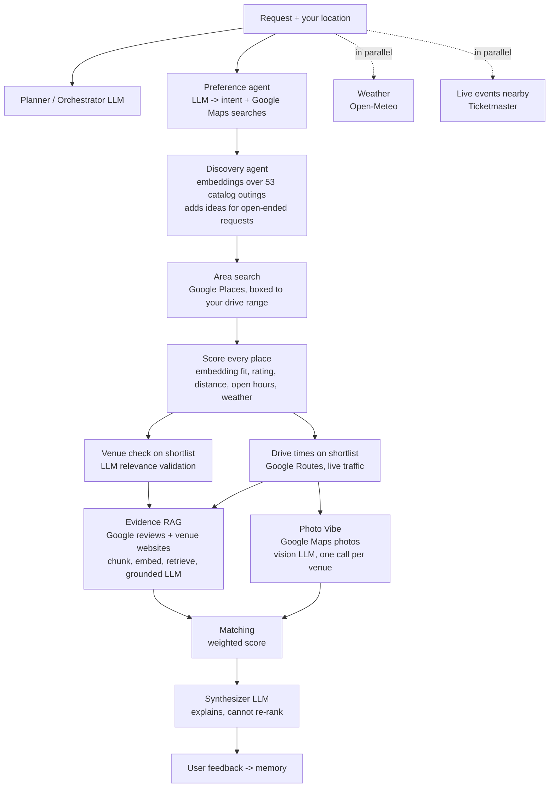

# Tonight, Sorted: an adaptive agentic activity recommender

**[Try the live demo →](https://YOUR-APP-NAME.streamlit.app)**

Describe a plan in plain English, like *"four of us want something fun and social tonight, not too expensive"*, and the app returns three real, nearby places with an explanation of why each one fits.

Behind the scenes, a planner LLM decides which specialist agents the request actually needs (weather, live events, drive times, venue websites, venue photos), runs them side by side where it can, adapts when a step comes back empty, and ranks the results with transparent, deterministic scoring. The app shows its work: every agent it ran or skipped, why, and how each venue was scored.

Started as a final project for **Analytics for Unstructured Data** (MSBA, McCombs School of Business, UT Austin, Fall 2026) and extended since as a personal project.

<!-- Add a screenshot: save one as docs/screenshot.png and uncomment the next line -->
<!--  -->

## How it works

The app starts from **where you are** (your browser's location, or any address you type) and searches Google Maps around you. Every place found is scored and shown on a map and in a full list; the top three get a closer look and a written explanation.



The whole search is one function, `run_pipeline()` in [`recommender/pipeline.py`](recommender/pipeline.py). It's written as numbered steps, and each agent file starts with the step number it belongs to, so the best way to follow the code is to read `pipeline.py` top to bottom and open each agent as it comes up.

| Step | Agent | File | What it does | Method |
|---|---|---|---|---|
| 1 | Planner | `agents/planner.py` | Chooses which agents a request needs; code enforces dependencies and a call limit | LLM + Python validation |
| 1 | Preference | `agents/preference.py` | Turns free text into group size, budget, likes, dislikes, a time, and Google Maps searches | LLM, JSON output |
| 2 | Discovery | `agents/discovery.py` | Ranks the catalog's real outings by meaning; adds ideas for open-ended requests | `all-MiniLM-L6-v2` embeddings + group/budget/category fit |
| 3 | Weather | `agents/weather.py` | Outdoor suitability score for the planned time | Open-Meteo, rule-based |
| 4 | Place search | `agents/place_search.py` | Every search phrase, boxed to your drive range | Google Places API (New) |
| 5 | Scoring | `agents/place_scoring.py` | Scores every place found: fit, rating, distance, open hours, weather | Embeddings + simple math |
| 6 | Shortlist | `agents/shortlist.py` | One listing per business, no smoke shops, some variety | Python rules |
| 7 | Venue check | `agents/relevance.py` | Removes places that only sound related ("business idea" -> an economic development office) | LLM, batches checked in parallel |
| 8 | Travel time | `agents/travel_time.py` | Live drive times, then the drive limit | Google Routes API |
| 9a | Review + website evidence | `agents/review_rag.py` | Judges fit from Google reviews and the venue's own site | Chunking, embeddings, top-k retrieval, grounded LLM (one call per venue, in parallel) |
| 9b | Photo vibe | `agents/photo_vibe.py` | Judges the atmosphere from Google Maps photos (cozy, lively, romantic...) | Vision LLM, one call per venue, in parallel; skipped when the look doesn't matter |
| 10 | Matching | `agents/matching.py` | Final ranking | Relative weights: 40 activity fit, 25 venue quality, 15 travel, 20 evidence, 15 photo vibe |
| 11 | Write-up | `agents/writeup.py` | Plain-language explanation; code checks it kept the ranking | LLM |
| - | Events | `agents/events.py` | Concerts, sports and shows near you in the time window (own tab) | Ticketmaster Discovery API |
| - | Memory + feedback | `agents/memory.py` | Your feedback becomes memory: skips searches for things you're not into, drops places you rejected | LLM + Python |

**Speed:** agents that don't depend on each other run at the same time: weather and events run during planning, the Maps searches run together, drive times and reviews load during the venue check, the venue check is split into small batches checked at once, and the website-evidence and photo agents run side by side with one call per venue. LLM latency mostly depends on how much the model writes, so several short calls at once finish much sooner than one long one.

**Design principle:** LLMs interpret and explain; Python does all arithmetic. When a signal is missing (no starting point, no website), it is dropped and the remaining weights are re-normalized rather than filled with a made-up value.

## Run it locally

```bash
git clone https://github.com/YOUR-USERNAME/activity-recommender.git
cd activity-recommender
python -m venv .venv && source .venv/bin/activate   # Windows: .venv\Scripts\activate
pip install -r requirements.txt

cp .streamlit/secrets.toml.example .streamlit/secrets.toml   # then add your keys
streamlit run app.py
```

The activity catalog lives in `data/activities_catalog.csv` (196 rows). To rebuild it from the raw Kaggle file:

```bash
python scripts/build_catalog.py path/to/activity.json
```

## API keys

| Key | Needed for | Notes |
|---|---|---|
| `ANTHROPIC_API_KEY` | Every LLM step (Claude Haiku 5.5 by default, set `LLM_MODEL` to change) | Required; create it at platform.claude.com (API billing is separate from a Claude subscription) |
| `GOOGLE_MAPS_API_KEY` | Venues and drive times | Enable **Places API (New)** and **Routes API** |
| `TICKETMASTER_API_KEY` | Live events | Optional; the Events agent is skipped without it |

Weather uses Open-Meteo, which needs no key. The Photo Vibe agent uses the same Google key (Places API (New) photos) and needs a vision-capable `LLM_MODEL` (every current Claude model is); set `photo_vibe` to `"off"` in `recommender/config.py` to turn it off.

## Deploy your own copy (Streamlit Community Cloud)

1. Push this repo to GitHub (public).
2. Go to [share.streamlit.io](https://share.streamlit.io), sign in with GitHub, and choose **Create app**.
3. Pick the repo, branch `main`, and main file `app.py`. Under **Advanced settings**, choose Python 3.12 and paste the contents of your `secrets.toml` into **Secrets**.
4. Pick a custom subdomain, then **Deploy**. The first build takes a few minutes while PyTorch and the embedding model install.

### Keeping a public demo affordable

Every search calls paid APIs, so the app limits searches per visitor (`RUNS_PER_SESSION`) and per day (`RUNS_PER_DAY`). Also set limits on the provider side:

- **Anthropic:** set a monthly spend limit in the Claude Console's billing / limits settings.
- **Google Cloud:** restrict the key to Places API (New) and Routes API, and set per-day request quotas for each. Each photo the Photo Vibe agent downloads is a billed Place Photo request (up to 3 photos x 5 venues per search, only when the planner thinks the look matters).

Visitor memory is kept in the browser session only, so visitors never see or change each other's preferences.

## Live tracker (optional)

Every search and rating can be logged to a Google Sheet so you can see what people ask for, how long runs take, what they cost, and how often picks are rated helpful.

1. Create a Google Sheet, open **Extensions → Apps Script**, paste `tracker_apps_script.gs`, and set `TOKEN` to a random string.
2. Run `setup` once, then **Deploy → New deployment → Web app** (execute as you, access: anyone) and copy the `/exec` URL.
3. Add `TRACKER_URL` and `TRACKER_TOKEN` to the app's secrets.

Tabs: `Dashboard`, `Run_Log`, `Agent_Usage`, `Recommendations`, `User_Feedback`. No exact device location is stored. Logging runs in the background and never blocks or breaks the app.

## Tests

```bash
pip install pytest
python -m pytest -q
```

The tests run the full pipeline offline with every API and the embedding model faked (`tests/fakes.py`), so they need no keys and cost nothing. `test_pipeline.py` runs whole searches; `test_rules.py` covers the scoring and shortlist rules.

## Project structure

```
app.py                      the Streamlit page, put together from ui/
ui/
  sidebar.py                location, time, drive limit, memory panel
  picks.py                  the three ticket cards + rating and feedback
  details.py                tabs: all places, map, events, agent trace, scores
  styles.py, labels.py      CSS and on-page text
recommender/
  pipeline.py               run_pipeline(): the whole search, numbered steps 1-11
  agents/                   one file per agent (step number at the top of each)
  services/                 raw API calls: Google Places/Routes, Open-Meteo,
                            Ticketmaster, venue websites, location lookup, tracker
  core/                     config (keys + every tunable number), LLM wrapper,
                            cache, shared run state, catalog + embedding model
scripts/build_catalog.py    raw Kaggle file -> 196-row catalog
notebooks/                  the original research notebook from the course
tests/                      offline tests (fakes.py stands in for every API)
```

## Author

Built by Yashas Varma.

## Limitations and next steps

- Live events are shown alongside recommendations but are not yet ranked against venues.
- The Kaggle activity catalog has 196 generic concepts, and only 53 are outings you can find a venue for (the rest, like "Take a nap", are filtered out; see `recommender/outings.py`). That finding is why the app searches Google Maps around the visitor instead of relying on the catalog.
- Google returns at most 60 places per search phrase ("Search deeper" fetches all 60; the default is 20 to stay fast).
- Opening hours come from Google's weekly schedule and don't include holiday changes.
- Photo vibe judges a handful of Google photos, which can be old or unrepresentative; the agent is told to stay neutral when photos are unclear.
- The fixed (non-agentic) baseline from the research notebook is not exposed in the app; comparing the two on cost and quality is the natural next experiment.
