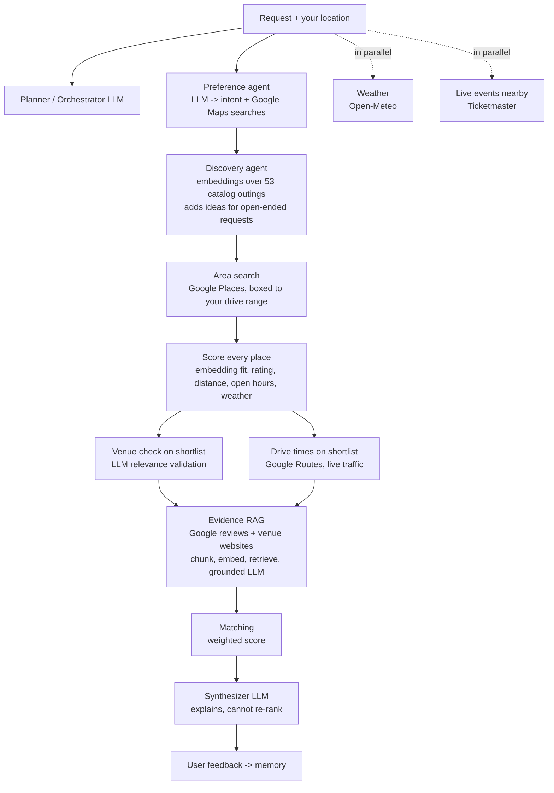

# Tonight, Sorted: an adaptive agentic activity recommender

**[Try the live demo →](https://YOUR-APP-NAME.streamlit.app)**

Describe a plan in plain English, like *"four of us want something fun and social tonight, not too expensive"*, and the app returns three real, nearby places with an explanation of why each one fits.

Behind the scenes, a planner LLM decides which specialist agents the request actually needs (weather, live events, drive times, venue websites), runs them, adapts when a step comes back empty, and ranks the results with transparent, deterministic scoring. The app shows its work: every agent it ran or skipped, why, and how each venue was scored.

Built as the final project for **Analytics for Unstructured Data** (MSBA, McCombs School of Business, UT Austin, Fall 2026).

<!-- Add a screenshot: save one as docs/screenshot.png and uncomment the next line -->
<!--  -->

## How it works

The app starts from **where you are** (your browser's location, or any address you type) and searches Google Maps around you. Every place found is scored and shown on a map and in a full list; the top three get a closer look and a written explanation.



The original city-and-catalog pipeline from the course notebook is kept in `recommender/workflow.py` (`run_adaptive_workflow`) for comparison; the app uses `recommender/nearby_workflow.py` (`run_nearby_workflow`).

| Agent | What it does | Method |
|---|---|---|
| Planner / Orchestrator | Chooses which agents a request needs; code enforces dependencies and a call limit | LLM + deterministic validation |
| Preference | Turns free text into city, group size, budget, likes, dislikes, hard vs. soft constraints | LLM, JSON output |
| Discovery | Ranks 196 activity concepts by meaning, not keywords | `all-MiniLM-L6-v2` embeddings, cosine similarity, plus group/budget/category fit |
| Memory | Applies earlier feedback: filters disliked concepts, boosts liked ones | Embedding similarity + narrow keyword filter |
| Weather | Scores outdoor suitability; penalizes outdoor activities more than indoor ones | Open-Meteo, rule-based |
| Local places | Finds real venues for the top activities | Google Places API (New) |
| Venue check | Removes venues that are only textually related to the activity | LLM validation |
| Travel time | Drive time with traffic from your starting point | Google Routes API |
| Live events | Concerts, sports and shows in the time window | Ticketmaster Discovery API |
| Website evidence (RAG) | Reads each venue's site and judges fit from retrieved passages only | Chunking, embeddings, top-k retrieval, grounded LLM |
| Matching | Final ranking | 40% activity fit, 25% venue quality, 15% travel, 20% website evidence |
| Synthesizer | Plain-language explanation; code verifies it kept the ranking | LLM |

**Design principle:** LLMs interpret and explain; Python does all arithmetic. When a signal is missing (no starting point, no website), it is dropped and the remaining weights are re-normalized rather than filled with a made-up value.

## Run it locally

```bash
git clone https://github.com/YOUR-USERNAME/activity-recommender.git
cd activity-recommender
python -m venv .venv && source .venv/bin/activate   # Windows: .venv\Scripts\activate
pip install -r requirements.txt

cp .streamlit/secrets.toml.example .streamlit/secrets.toml   # then add your keys
streamlit run app.py
```

The activity catalog lives in `data/activities_catalog.csv` (196 rows). To rebuild it from the raw Kaggle file:

```bash
python scripts/build_catalog.py path/to/activity.json
```

## Test it in Google Colab (no local setup)

Upload this repo as `activity-recommender.zip` to the project's Google Drive folder, open `Run Streamlit App (test).ipynb` in Colab, and choose **Runtime → Run all**. It reads the API keys from Colab Secrets, runs the offline tests and one real search, starts the app, and prints a temporary link.

## API keys

| Key | Needed for | Notes |
|---|---|---|
| `OPENAI_API_KEY` | Every LLM step | Required |
| `GOOGLE_MAPS_API_KEY` | Venues and drive times | Enable **Places API (New)** and **Routes API** |
| `TICKETMASTER_API_KEY` | Live events | Optional; the Events agent is skipped without it |

Weather uses Open-Meteo, which needs no key.

## Deploy your own copy (Streamlit Community Cloud)

1. Push this repo to GitHub (public).
2. Go to [share.streamlit.io](https://share.streamlit.io), sign in with GitHub, and choose **Create app**.
3. Pick the repo, branch `main`, and main file `app.py`. Under **Advanced settings**, choose Python 3.12 and paste the contents of your `secrets.toml` into **Secrets**.
4. Pick a custom subdomain, then **Deploy**. The first build takes a few minutes while PyTorch and the embedding model install.

### Keeping a public demo affordable

Every search calls paid APIs, so the app limits searches per visitor (`RUNS_PER_SESSION`) and per day (`RUNS_PER_DAY`). Also set limits on the provider side:

- **OpenAI:** set a monthly budget and usage limit in your organization's billing settings.
- **Google Cloud:** restrict the key to Places API (New) and Routes API, and set per-day request quotas for each.

Visitor memory is kept in the browser session only, so visitors never see or change each other's preferences.

## Live tracker (optional)

Every search and rating can be logged to a Google Sheet so the team can see what people ask for, how long runs take, what they cost, and how often picks are rated helpful.

1. Create a Google Sheet, open **Extensions → Apps Script**, paste `tracker_apps_script.gs`, and set `TOKEN` to a random string.
2. Run `setup` once, then **Deploy → New deployment → Web app** (execute as you, access: anyone) and copy the `/exec` URL.
3. Add `TRACKER_URL` and `TRACKER_TOKEN` to the app's secrets.

Tabs: `Dashboard`, `Run_Log`, `Agent_Usage`, `Recommendations`, `User_Feedback`. No exact device location is stored. Logging runs in the background and never blocks or breaks the app.

## Tests

```bash
pip install pytest
python -m pytest -q
```

The tests run the full pipeline offline with every API and the embedding model faked, so they need no keys.

## Project structure

```
app.py                     Streamlit UI
recommender/
  workflow.py              Adaptive workflow: plan -> agents -> adapt -> rank -> explain
  orchestrator.py          Planner LLM and plan validation
  preference.py            Request -> structured intent
  discovery.py             Embedding-based activity retrieval
  memory.py                Feedback agent, memory filter
  weather.py               Geocoding, forecast, weather-aware reranking
  places.py                Google Places search
  relevance.py             Venue/activity validation
  events.py                Ticketmaster events
  mobility.py              Google Routes travel time
  rag.py                   Website retrieval-augmented evidence
  matching.py              Final weighted ranking
  synthesizer.py           Grounded explanation
  llm.py, config.py, base.py, data.py   Shared plumbing
scripts/build_catalog.py   Raw Kaggle file -> 196-row catalog
tests/                     Offline end-to-end tests
```

## Team

Built by [Jacob Posner](https://www.linkedin.com/in/YOUR-LINKEDIN) with TEAMMATE NAMES as a group project for MSBA Analytics for Unstructured Data, taught by Dr. Anitesh Barua.

## Limitations and next steps

- Live events are shown alongside recommendations but are not yet ranked against venues.
- The Kaggle activity catalog has 196 generic concepts, and only 53 are outings you can find a venue for (the rest, like "Take a nap", are filtered out; see `recommender/outings.py`). That finding is why the app searches Google Maps around the visitor instead of relying on the catalog.
- Google returns at most 60 places per search phrase ("Search deeper" fetches all 60; the default is 20 to stay fast).
- Opening hours come from Google's weekly schedule and don't include holiday changes.
- Image-based "vibe" analysis of venue photos was scoped but not built.
- The fixed (non-agentic) baseline from the research notebook is not exposed in the app; comparing the two on cost and quality is the natural next experiment.
