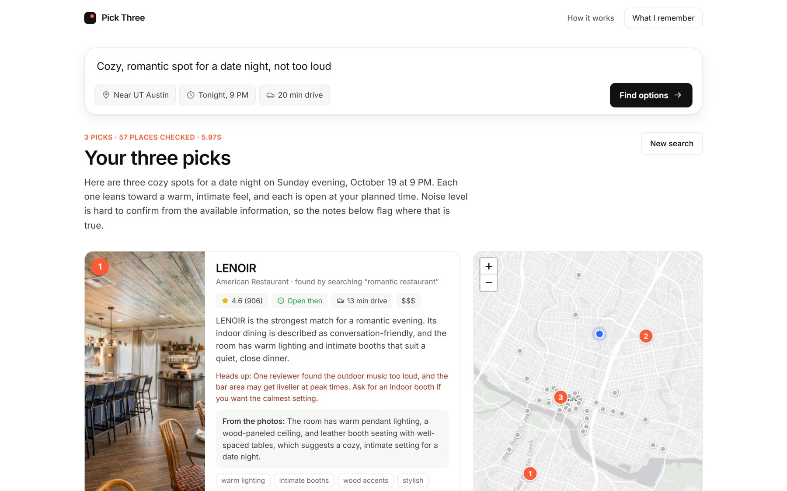
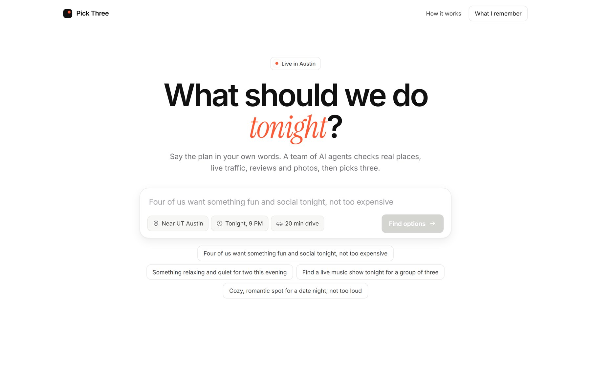
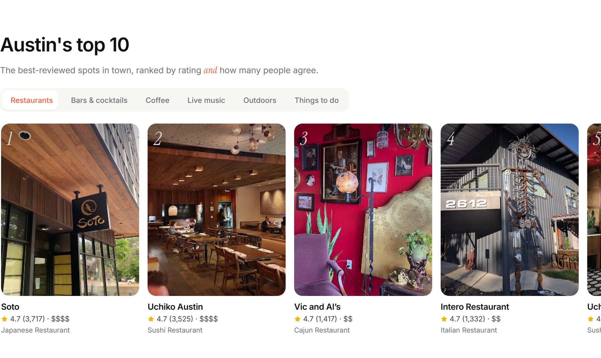
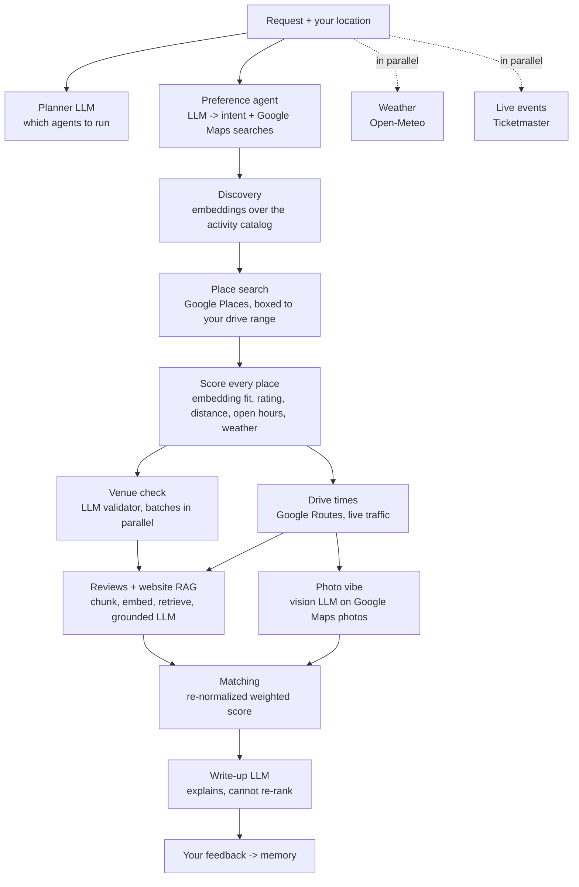

# Pick Three

**An agentic activity recommender.** Describe a plan in plain English, like *"four of us want something
fun and social tonight, not too expensive"*, and thirteen small AI agents check real places, live traffic,
reviews and photos, then pick three, with a written explanation of why each one fits.

**[Try it live →](https://pick-three-922459864103.us-central1.run.app)** &nbsp;·&nbsp; 3 free searches per visitor per day



Not a single chatbot guess: an LLM planner decides which specialists a request needs, plain math does
the ranking, and the LLMs are only allowed to interpret and explain. The site shows its work: every agent
it ran or skipped, why, and how each place was scored.

Started as my final project for **Analytics for Unstructured Data** (MSBA, McCombs School of Business,
UT Austin) and rebuilt since as a personal project.

## Highlights

| | |
|---|---|
| **Review-adjusted ratings** | Bayesian average, `(v·r + m·C) / (v + m)` with m = 40, so a 5.0 from 12 reviews doesn't beat a 4.7 from 3,000 |
| **Semantic matching** | `all-MiniLM-L6-v2` sentence embeddings (run with fastembed on ONNX Runtime, no PyTorch) and cosine similarity match the request to places by meaning, not keywords |
| **Honest missing data** | When a signal is missing (no drive time, no website, no photos) it's dropped and the weights re-normalized, never filled with a guess |
| **Retrieval-augmented evidence** | Reviews and venue websites are chunked (700 chars, 120 overlap), embedded and retrieved; the LLM judges fit from those passages only |
| **Vision** | For requests where the look matters, a vision model rates the atmosphere in Google Maps photos |
| **LLM guardrails** | The planner's plan is validated against a dependency graph and call budget; a validator drops look-alike places; the write-up must keep the exact ranking |
| **Entity resolution** | Duplicate listings and chain branches merged by name tokens, website domain and haversine distance |
| **Fast and cheap** | Independent agents run concurrently; LLM checks fan out one call per venue; a single-flight TTL cache; ~25 s and ~$0.006 of LLM per search |
| **Tested** | 50 offline tests with every API mocked |

| Home page | Austin's top 10, before you search |
|---|---|
|  |  |

## How it works

The search starts from **where you are** (browser location or any address) and searches Google Maps
around you. Every place found is scored and shown on a map and in a full list; the top three get a closer
look and a write-up.



The whole search is one function, `run_pipeline()` in [`recommender/pipeline.py`](recommender/pipeline.py),
written as numbered steps. Each agent file starts with the step number it belongs to, so the easiest way
to follow the code is to read `pipeline.py` top to bottom and open each agent as it comes up.

| Step | Agent | File | What it does | Method |
|---|---|---|---|---|
| 1 | Planner | `agents/planner.py` | Chooses which agents a request needs; code enforces dependencies and a call limit | LLM + Python validation |
| 1 | Preference | `agents/preference.py` | Free text -> group size, budget, likes, dislikes, a time, and Google Maps searches | LLM, JSON output |
| 2 | Discovery | `agents/discovery.py` | Ranks the catalog's real outings by meaning; adds ideas for open-ended requests | Embeddings + group/budget/category fit |
| 3 | Weather | `agents/weather.py` | Outdoor suitability for the planned time | Open-Meteo, rule-based |
| 4 | Place search | `agents/place_search.py` | Every search phrase, boxed to your drive range | Google Places API (New) |
| 5 | Scoring | `agents/place_scoring.py` | Scores every place: fit, rating, distance, open hours, weather | Embeddings + Bayesian rating |
| 6 | Shortlist | `agents/shortlist.py` | One listing per business, no smoke shops, some variety | Python rules |
| 7 | Venue check | `agents/relevance.py` | Removes places that only sound related | LLM, batches of 4 in parallel |
| 8 | Travel time | `agents/travel_time.py` | Live drive times, then the drive limit | Google Routes API |
| 9a | Reviews + website | `agents/review_rag.py` | Judges fit from Google reviews and the venue's own site | RAG, one LLM call per venue in parallel |
| 9b | Photo vibe | `agents/photo_vibe.py` | Judges the atmosphere from Google Maps photos | Vision LLM, skipped when the look doesn't matter |
| 10 | Matching | `agents/matching.py` | Final ranking | Weights 40 fit · 25 quality · 15 travel · 20 evidence · 15 vibe |
| 11 | Write-up | `agents/writeup.py` | Plain-language explanation; code checks it kept the ranking | LLM |
| - | Events | `agents/events.py` | Concerts, sports and shows near you in the time window | Ticketmaster Discovery API |
| - | Memory | `agents/memory.py` | Feedback becomes memory: skips what you're not into, drops places you rejected | LLM + Python |

## Run it locally

```bash
git clone https://github.com/yashasvarma14/pick-three.git
cd pick-three
python -m venv .venv && source .venv/bin/activate   # Windows: .venv\Scripts\activate
pip install -r requirements.txt

cp .streamlit/secrets.toml.example .streamlit/secrets.toml   # then add your keys
python scripts/build_featured.py                             # the home page's "Austin's top 10" lists
uvicorn api.main:app --port 8000                             # open http://localhost:8000
```

The original Streamlit version still works: `pip install -r requirements-streamlit.txt`, then `streamlit run app.py`.

## API keys

| Key | Needed for | Notes |
|---|---|---|
| `ANTHROPIC_API_KEY` | Every LLM step (Claude Haiku by default; `LLM_MODEL` to change) | From platform.claude.com (API billing is separate from a Claude subscription) |
| `GOOGLE_MAPS_API_KEY` | Places, reviews, photos, drive times | Enable **Places API (New)** and **Routes API** |
| `TICKETMASTER_API_KEY` | Live events | Optional; the Events agent is skipped without it |

Weather uses Open-Meteo, which needs no key. Every tunable number (search counts, thresholds, weights)
is in [`recommender/core/config.py`](recommender/core/config.py).

## Deploy (Google Cloud Run)

The `Dockerfile` runs the API and the website together in one container. Cloud Run builds and hosts it,
scales to zero when nobody is using it, and its free tier covers thousands of searches a month.

1. Install the Google Cloud CLI (`winget install Google.CloudSDK`), then `gcloud auth login` and
   `gcloud config set project YOUR-PROJECT-ID`.
2. `python scripts/deploy_cloudrun.py` (re-run to push updates; nothing redeploys on its own). Keys are
   copied from `.streamlit/secrets.toml` into the service's settings; the file itself is never uploaded.
3. It's **private** by default (only your Google account, via
   `gcloud run services proxy pick-three --region us-central1 --port 8080`). Add `--public` for a shareable link.

### Keeping a public demo affordable

The live site allows 3 searches per visitor per day and 10 in total (`RUNS_PER_VISITOR_PER_DAY`, `RUNS_PER_DAY`);
visitors are identified by the proxy-added address, so a faked header can't reset the limit. The top-10
lists come from a snapshot (`scripts/build_featured.py`, about once a month; it isn't committed because
Google's terms limit storing place data), so page views make no Google searches. Also set provider limits:

- **Anthropic:** a monthly spend limit in the Claude Console.
- **Google Cloud:** restrict the key to Places API (New) and Routes API, set per-day quotas, and add a $1 budget alert.

Visitor memory lives in the visitor's browser only, so nobody sees or changes anyone else's preferences.

## Tests

```bash
pip install pytest httpx
python -m pytest -q
```

50 tests, all offline: every API and the embedding model are faked (`tests/fakes.py`), so they need no keys
and cost nothing. `test_pipeline.py` runs whole searches, `test_rules.py` covers scoring and shortlist rules,
`test_api.py` covers the website's endpoints and search limits.

## Project structure

```
web/                        the website: index.html, css/, js/ (vanilla JS modules, Leaflet map)
api/                        FastAPI backend: search (streamed progress), write-up, feedback, top-10, photos
recommender/
  pipeline.py               run_pipeline(): the whole search, numbered steps 1-11
  agents/                   one file per agent (step number at the top of each)
  services/                 raw API calls: Google Places/Routes, Open-Meteo, Ticketmaster, websites
  core/                     config, LLM wrapper, cache, shared run state, catalog + embedding model
scripts/                    build_featured.py, build_catalog.py, deploy_cloudrun.py
tests/                      offline tests (fakes.py stands in for every API)
app.py, ui/                 the original Streamlit version
Dockerfile                  the Cloud Run container
```

## Limitations and next steps

- Live events are shown next to the recommendations but not yet ranked against venues.
- The activity catalog has 196 generic concepts and only 53 are outings you can find a venue for, which is
  why the search goes to Google Maps around the visitor instead of relying on the catalog.
- Google returns at most 60 places per search phrase ("Search deeper" fetches all 60; the default is 20).
- Opening hours come from Google's weekly schedule and don't include holiday changes.
- Photo vibe judges a handful of Google photos, which can be old or unrepresentative.
- Next experiment: compare this pipeline against a single LLM call with web search, on accuracy and cost.

## Author

Built by Yashas Varma. The website's design and front end were made with Claude (Anthropic).
